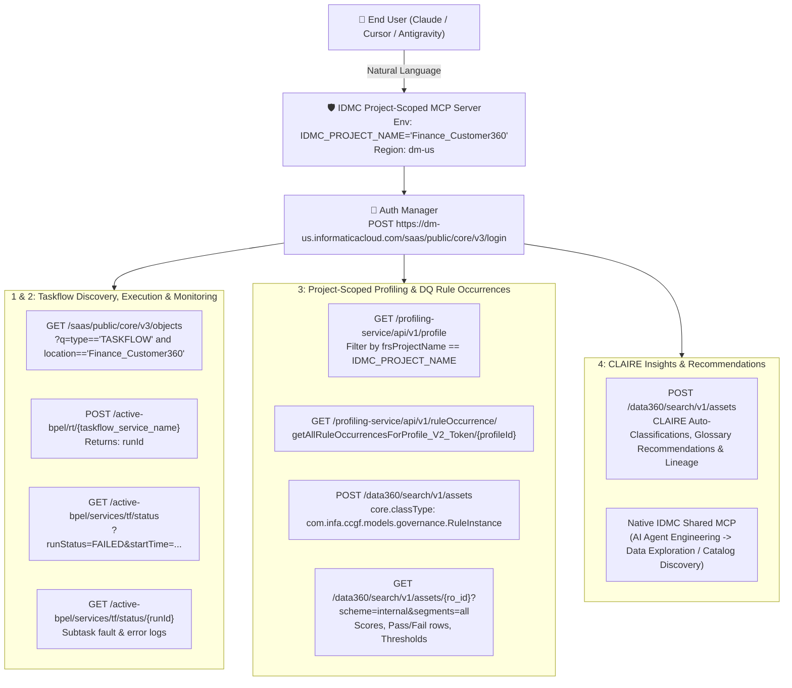

# Informatica IDMC MCP Server Proposal & Implementation Plan 🚀🤖

## Goal Description

Design and scaffold a complete architectural proposal, API evaluation guide, connection tutorial, and reference **Model Context Protocol (MCP) Server** inside [`c:/obData/investigating-informatica-idmc-mcp/`](file:///c:/obData/investigating-informatica-idmc-mcp/) (locked to the **`dm-us`** region) to solve five core business objectives using Informatica Intelligent Data Management Cloud (IDMC) APIs (Platform REST API v2/v3, ActiveVOS Taskflow APIs, Cloud Data Profiling API, CDGC Search/Governance API, and CLAIRE Metadata/Agent APIs):

1. **Taskflow Monitoring & Error Triage:** Identify which taskflows have executed and isolate runs that ended with errors (`FAILED` / `SUSPENDED`), including subtask-level fault details.
2. **Zero-Friction Project Taskflow Execution:** Allow an end user (via LLM/MCP) to list and execute taskflows within their project by human-readable name, completely abstracting the multi-step API chain (`Login` $\rightarrow$ `Object Lookup` $\rightarrow$ `Service URL Resolution` $\rightarrow$ `Execution` $\rightarrow$ `Run ID Tracking`).
3. **Hardcoded Project-Scoped Profiling & Data Quality Rule Occurrences:** Retrieve Data Profiling metrics and CDGC Data Quality Rule Occurrence scores strictly scoped to a single **hardcoded project** configured at the MCP server environment level (`IDMC_PROJECT_NAME`), ensuring tenant/project isolation per user without requiring the user to pass project IDs.
4. **CLAIRE APIs for Metadata & Quality Insights:** Evaluate and integrate Informatica CLAIRE capabilities (CDGC semantic classifications, glossary/relationship recommendations, DQ score drift insights, and native CLAIRE Shared MCP Agents).
5. **Step-by-Step Informatica MCP Connection Tutorial:** Document all three integration patterns:
   - **Pattern A:** Informatica Native Shared MCP Servers (*IDMC AI Agent Engineering $\rightarrow$ Shared MCP Servers*).
   - **Pattern B:** Informatica Self-Managed MCP Server via *Cloud Application Integration (CAI)*.
   - **Pattern C:** Custom Python `FastMCP` Server enforcing hardcoded single-project isolation.

---

## Architectural Overview & API Chain Mapping (`dm-us`)

---

## Implemented Deliverables Status (`c:/obData/investigating-informatica-idmc-mcp/`)

- [x] [`PLAN.md`](file:///c:/obData/investigating-informatica-idmc-mcp/PLAN.md) — This implementation plan.
- [x] [`status.md`](file:///c:/obData/investigating-informatica-idmc-mcp/status.md) — Live progress tracker with all 6 phases completed and crossed off.
- [x] [`README.md`](file:///c:/obData/investigating-informatica-idmc-mcp/README.md) — Executive overview and quickstart guide.
- [x] [`docs/01_API_Evaluation_and_MCP_Proposal.md`](file:///c:/obData/investigating-informatica-idmc-mcp/docs/01_API_Evaluation_and_MCP_Proposal.md) — Deep-dive evaluation of all IDMC APIs, `dm-us` endpoints, behind-the-scenes API chains, and CLAIRE capabilities.
- [x] [`docs/02_Tutorial_Connect_Informatica_MCP.md`](file:///c:/obData/investigating-informatica-idmc-mcp/docs/02_Tutorial_Connect_Informatica_MCP.md) — Step-by-step connection tutorial for Native Shared MCP, CAI Self-Managed MCP, and Custom Python MCP.
- [x] [`src/idmc_client.py`](file:///c:/obData/investigating-informatica-idmc-mcp/src/idmc_client.py) — Async client with `dm-us` pod auto-discovery, hardcoded `IDMC_PROJECT_NAME` enforcement, and Mock + Live modes.
- [x] [`src/idmc_mcp_server.py`](file:///c:/obData/investigating-informatica-idmc-mcp/src/idmc_mcp_server.py) — `FastMCP` server exposing the 5 project-scoped tools and `idmc://project/summary` resource.
- [x] [`mcp.json.example`](file:///c:/obData/investigating-informatica-idmc-mcp/mcp.json.example) — Ready-to-use MCP configuration for `dm-us`.
- [x] [`tests/test_idmc_mcp.py`](file:///c:/obData/investigating-informatica-idmc-mcp/tests/test_idmc_mcp.py) — Automated test suite (7/7 tests passing).
