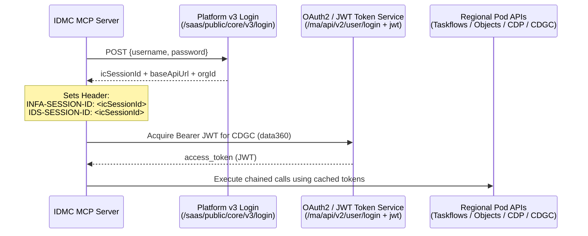
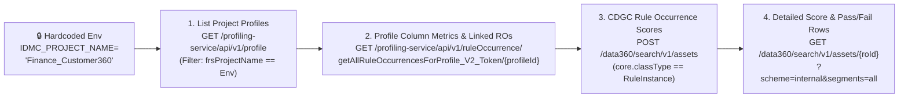

# Informatica IDMC API Evaluation & Project-Scoped MCP Server Proposal 🏛️🤖

## 1. Executive Summary & Architectural Premise

Organizations adopting **Informatica Intelligent Data Management Cloud (IDMC)** interact with four distinct API families across Data Integration, Data Profiling, Data Governance, and AI:
1. **Platform REST APIs (v2 & v3):** Authentication (`/saas/public/core/v3/login`, `/ma/api/v2/user/login`), metadata object lookup (`/saas/public/core/v3/objects`), and job lifecycle control.
2. **ActiveVOS / Cloud Application Integration (CAI) Taskflow APIs:** Taskflow execution (`/active-bpel/rt/<Taskflow_Service_Name>`) and execution monitoring (`/active-bpel/services/tf/status`).
3. **Cloud Data Profiling (CDP) REST API:** Profile discovery (`/profiling-service/api/v1/profile`), profile runs, and profile-linked Rule Occurrences (`/profiling-service/api/v1/ruleOccurrence/getAllRuleOccurrencesForProfile_V2_Token/{profileId}`).
4. **Cloud Data Governance & Catalog (CDGC) & CLAIRE APIs:** Asset search (`/data360/search/v1/assets`), Data Quality Rule Occurrence scores (`com.infa.ccgf.models.governance.RuleInstance`), score publishing (`/data-quality/v1/rule-occurrences/runs`), and CLAIRE metadata recommendations & auto-classifications.

### Why a Project-Scoped MCP Server Is Essential
Directly exposing raw Informatica REST endpoints to an LLM fails in enterprise environments for three reasons:
- **Multi-Step API Chaining:** Executing a taskflow by name or getting profiling + DQ rule occurrence scores requires **3 to 5 sequential API calls** across different regional base URLs (`<pod>.dm-us`, `<pod>-dqprofile.dm-us`, `idmc-api.dm-us`) and different auth headers (`INFA-SESSION-ID`, `IDS-SESSION-ID`, `Authorization: Bearer <JWT>`).
- **Cryptic Internal Identifiers:** Native endpoints require internal FRS object IDs, Profile UUIDs, or CDGC Technical Asset URIs that business users never know.
- **Strict Single-Project Tenant Isolation (Requirement #3):** Every end user only has access to **one specific Informatica Project** (e.g., `Finance_Customer360`). By hardcoding `IDMC_PROJECT_NAME` in the MCP server's environment configuration (`.mcp.json`), the user never needs to specify a project parameter, and the MCP server guarantees that no API query can ever leak or trigger assets outside that assigned project.

---

## 2. Authentication & Multi-Endpoint URL Matrix

Before executing any business workflow, the MCP server manages a unified authentication session behind the scenes:



| API Family | `dm-us` Base URL Pattern (Auto-Derived from Pod) | Required Auth Header |
| :--- | :--- | :--- |
| **Global `dm-us` Login (v3 / v2)** | `https://dm-us.informaticacloud.com/saas/public/core/v3/login` | `Content-Type: application/json` |
| **Platform REST API v3 (Objects)** | `https://<pod>.dm-us.informaticacloud.com/saas` | `INFA-SESSION-ID: <sessionId>` |
| **Taskflow Execution & Status** | `https://<pod>.dm-us.informaticacloud.com/active-bpel` | `INFA-SESSION-ID: <sessionId>` or `Authorization: Basic <b64>` |
| **Cloud Data Profiling (CDP)** | `https://<pod>-dqprofile.dm-us.informaticacloud.com` | `IDS-SESSION-ID: <sessionId>` |
| **CDGC & CLAIRE Metadata (`dm-us`)** | `https://idmc-api.dm-us.informaticacloud.com` | `Authorization: Bearer <JWT_Token>` + `X-INFA-ORG-ID: <orgId>` |

> [!NOTE]
> **Automatic `dm-us` Pod Discovery (`na1`, `na2`, `usw1`, `usw3`, `usw5`, `use4`, `use6`):**
> When `InformaticaIDMCClient` authenticates against `https://dm-us.informaticacloud.com/saas/public/core/v3/login`, Informatica returns `products[0].baseApiUrl` (e.g., `https://usw5.dm-us.informaticacloud.com/saas`). The MCP client automatically extracts your exact `dm-us` pod prefix (`<pod>`) and configures both the ActiveVOS Taskflow URL (`https://<pod>.dm-us.informaticacloud.com/active-bpel`) and the Cloud Data Profiling URL (`https://<pod>-dqprofile.dm-us.informaticacloud.com`).

---

## 3. Business Issue #1: Monitor Taskflows & Identify Errors

### Business Goal
> *"Know which taskflows have run and which ones have ended with errors (monitor the taskflows) within the user's project."*

### Underlying Informatica APIs Evaluated
1. **Project Asset Resolution (`GET /saas/public/core/v3/objects`):**
   - Queries all `TASKFLOW` objects inside the hardcoded project (`q=type=='TASKFLOW' and location=='<IDMC_PROJECT_NAME>'`).
2. **Taskflow Status Summary API (`GET /active-bpel/services/tf/status`):**
   - **Important Nuance:** Do *not* include `/saas` in the URL path.
   - **Supported Query Parameters:**
     - `startTime=2026-11-09T00:00:00Z` & `endTime=2026-11-10T23:59:59Z`
     - `runStatus=FAILED` (Allowed values: `SUCCESS`, `FAILED`, `RUNNING`, `SUSPENDED`, `WARNING`)
     - `rowLimit=50` & `offset=0`
3. **Taskflow Run Fault Drill-Down (`GET /active-bpel/services/tf/status/{runId}`):**
   - Retrieves subtask details (`subtasks[]`), pinpointing which specific Mapping Task or Command Task inside the Taskflow failed, its fault code, and its error log message.

### Proposed MCP Tool: `get_taskflow_runs`
- **Exposed Parameters to LLM:**
  - `status_filter` (`"ALL"` | `"FAILED"` | `"RUNNING"` | `"SUCCESS"` | `"SUSPENDED"`, default: `"ALL"`)
  - `hours_back` (`int`, default: `24`)
  - `include_error_details` (`bool`, default: `True` — automatically drills into `/status/{runId}` for failed/suspended runs)
- **Hidden Behind-the-Scenes Chain:**
  1. Ensures valid `INFA-SESSION-ID`.
  2. Fetches the list of allowed taskflows in `IDMC_PROJECT_NAME`.
  3. Queries `/active-bpel/services/tf/status` for the time window and filters results strictly to taskflows belonging to `IDMC_PROJECT_NAME`.
  4. For every run with status `FAILED` or `SUSPENDED`, calls `/active-bpel/services/tf/status/{runId}` to attach the failing subtask name and exact error message.

---

## 4. Business Issue #2: Discover & Execute Taskflows by Project Without Knowing the API Chain

### Business Goal
> *"Try to execute taskflows within a project, so the user can with the name of the project (or hardcoded project) get the existing taskflows and execute them by using the MCP server without knowing the chain of API calls done behind the scenes."*

### Underlying Informatica APIs Evaluated
1. **Asset Discovery (`GET /saas/public/core/v3/objects`):**
   ```http
   GET https://<pod>.dm-us.informaticacloud.com/saas/public/core/v3/objects?q=type=='TASKFLOW'
   INFA-SESSION-ID: <sessionId>
   ```
   Returns `id` (FRS ID), `name` (e.g., `tf_Load_Customer_Dim`), `path` (e.g., `Finance_Customer360/ETL_Pipelines`), and `description`.
2. **Taskflow Execution Endpoint (`POST /active-bpel/rt/<Taskflow_Unique_Service_Name>`):**
   - Note: In IDMC, a Taskflow must be **Published** with "Allowed Users / Groups" configured to expose its REST/SOAP service URL.
   - Triggering it returns:
     ```json
     {
       "runId": 914510835553251328
     }
     ```
3. **Execution Status Polling (`GET /active-bpel/services/tf/status/{runId}`):**
   - Checks whether the triggered `runId` is `RUNNING`, `SUCCESS`, or `FAILED`.

### Proposed MCP Tools: `list_project_taskflows` & `execute_project_taskflow`
- **`list_project_taskflows()`:**
  - Takes **zero mandatory arguments** (uses hardcoded `IDMC_PROJECT_NAME`).
  - Returns all taskflows inside `IDMC_PROJECT_NAME` along with their folder path, description, and readiness status.
- **`execute_project_taskflow(taskflow_name: str, input_fields: dict | None = None, wait_for_initial_status: bool = True)`:**
  - **Step 1 (Security Gate):** Queries `/saas/public/core/v3/objects` to verify that `taskflow_name` actually resides inside `IDMC_PROJECT_NAME`. If it belongs to another project, execution is **blocked**.
  - **Step 2 (Trigger):** Calls `POST https://<pod>.dm-us.informaticacloud.com/active-bpel/rt/<taskflow_name>` with `INFA-SESSION-ID` and `input_fields`.
  - **Step 3 (Verify):** Captures `runId`, checks `/active-bpel/services/tf/status/{runId}`, and returns a structured execution receipt to the user.

---

## 5. Business Issue #3: Hardcoded Project-Oriented Profiling & Data Quality Rule Occurrences

### Business Goal
> *"Try to get results for profiling and quality of the rule occurrences always, thinking as 'project' oriented. It means that's the only set from the end user, and in fact this value is somehow hardcoded, because every user will have access to only one project."*

### Why This Requires Chaining CDP + CDGC APIs
In IDMC, **Data Profiling** lives in the Cloud Data Profiling microservice (`profiling-service`), while **Scorecards & Data Quality Rule Occurrences** are governed and scored in **CDGC** (`data360/search/v1/assets` and `data-quality/v1/rule-occurrences`). A user asking *"How is the data quality and profiling in my project?"* needs both combined seamlessly.



### Underlying Informatica APIs Evaluated
1. **List Profiles in Organization (`GET /profiling-service/api/v1/profile`):**
   - Header: `IDS-SESSION-ID: <sessionId>`
   - Returns profile objects containing `id`, `name`, `frsProjectName` (or `projectId`), `profileType` (`COLUMN_PROFILE`), and `sourceConnectionName`.
   - **MCP Project Filter:** The MCP server filters the list in-memory so only profiles where `frsProjectName == IDMC_PROJECT_NAME` are processed.
2. **Fetch Profile Runs & Column Metrics (`GET /profiling-service/api/v1/profile/{profileId}/results` or `/runs`):**
   - Returns row counts, column null counts/percentages, distinct value counts/percentages, inferred data types, and value frequency patterns.
3. **Fetch Rule Occurrences Linked to a Profile (`GET /profiling-service/api/v1/ruleOccurrence/getAllRuleOccurrencesForProfile_V2_Token/{profileId}`):**
   - Bridges Cloud Data Profiling (`profileId`) to the specific **Rule Occurrence IDs** (`ruleOccurrenceId`) evaluated during the profile run.
4. **Query CDGC Rule Occurrences & Quality Scores (`POST /data360/search/v1/assets?knowledgeQuery=*&segments=all`):**
   - Payload:
     ```json
     {
       "from": 0,
       "size": 100,
       "filterSpec": [
         {
           "type": "simple",
           "attribute": "core.classType",
           "values": ["com.infa.ccgf.models.governance.RuleInstance"]
         }
       ]
     }
     ```
   - Followed by `GET /data360/search/v1/assets/{rule_occurrence_id}?scheme=internal&segments=all` to extract:
     - **Quality Dimension:** Completeness, Accuracy, Validity, Consistency, Timeliness
     - **DQ Score (%):** e.g., `94.2%` vs Target Threshold `98.0%` (`Threshold Breached` / `Passed`)
     - **Row Metrics:** `totalRows`, `passedRows`, `failedRows`
     - **Primary Data Element / Business Term:** Linked governance context

### Proposed MCP Tool: `get_project_profiling_and_dq_scores`
- **Exposed Parameters to LLM:**
  - `profile_or_table_filter` (`str | None`, optional keyword like `"CUSTOMER"` or `"INVOICE"`)
  - `only_failing_rules` (`bool`, default: `False` — when `True`, highlights only Rule Occurrences whose score fell below target threshold)
- **Zero Project Parameter Exposed:** The tool reads `IDMC_PROJECT_NAME` directly from the server configuration.

---

## 6. Business Issue #4: How to Use CLAIRE APIs to Get Insights

### Understanding Informatica CLAIRE's API Surface
In IDMC, **CLAIRE®** (Informatica's metadata-driven AI engine) does not exist as a single monolithic `/claire` endpoint. Instead, CLAIRE insights are surfaced through **three programmable layers**:

#### Layer A: CLAIRE Enriched Metadata via CDGC Search & Asset APIs (`/data360/search/v1/assets`)
When Catalog Source jobs run in IDMC with **Data Classification**, **Relationship Discovery**, and **Data Quality Automation** enabled, CLAIRE writes its AI inferences directly into the `ccgf` metadata graph. You retrieve these insights via REST:
1. **CLAIRE Auto-Classification & Semantic Domains:**
   - Attribute: `core.autoClassification` / `com.infa.odin.models.classification.DataClassification`
   - Insights returned: CLAIRE-detected PII/PCI sensitivity (`SSN`, `Email`, `Credit_Card`, `IBAN`), confidence scores, and semantic column domains.
2. **CLAIRE Business Glossary & Term Recommendations:**
   - Attribute: Recommended glossary associations awaiting steward approval (`core.stakeholderRecommendations` / `core.recommendedBusinessTerms`).
3. **CLAIRE PK/FK & Join Relationship Discovery:**
   - Attribute: Inferred structural relationships between tables across schemas based on column value overlap during profiling.
4. **CLAIRE Data Quality Anomaly & Drift Detection:**
   - Historical score deltas across Rule Occurrence runs (`POST /data-quality/v1/rule-occurrences/runs` & CDGC observability segments), flagging rules where score dropped sharply compared to prior runs.

#### Layer B: Native IDMC CLAIRE Shared MCP Agents (*AI Agent Engineering*)
Informatica now provides native **CLAIRE-powered Shared MCP Servers** inside **IDMC $\rightarrow$ AI Agent Engineering $\rightarrow$ MCP Servers**:
- **`Catalog Discovery` / `Data Exploration` MCP Server:** Exposes native CLAIRE skills (`data_explore`, semantic search, lineage traversal, and natural-language-to-catalog queries) over Server-Sent Events (SSE).
- **`MDM` & `Job Management` MCP Servers:** Exposes master entity resolution and basic job status lookups.

#### Layer C: Proposed Custom MCP Tool — `get_claire_project_insights`
To give the project-scoped user immediate, actionable CLAIRE intelligence tied to their hardcoded project (`IDMC_PROJECT_NAME`), our MCP server exposes `get_claire_project_insights(focus_area)`:
- **Combines 3 Signals for the Project:**
  1. **CLAIRE Data Classifications & PII Exposure:** Lists columns in the project's profiled datasets where CLAIRE detected sensitive PII/financial data classes (with confidence %) and checks whether those columns have active DQ Rule Occurrences.
  2. **CLAIRE Glossary & Rule Recommendations:** Surfaces unapproved CLAIRE business term recommendations and suggested DQ rules for high-null or anomalous columns.
  3. **CLAIRE Cross-Pipeline Root-Cause Insight:** Automatically correlates failed Taskflows (from Issue #1) with degraded Data Quality Rule Occurrences (from Issue #3) in the same project so the user sees: *"Taskflow `tf_Load_Customer_Dim` failed at step `m_Validate_TaxID` because Rule Occurrence `RO_CUST_TAX_ID_VALIDITY` dropped from 99.1% to 82.4%."*

---

## 7. Comparison: Native IDMC Shared MCP vs. Custom CAI MCP vs. Custom Python FastMCP

| Capability / Requirement | Native IDMC Shared MCP (*AI Agent Engineering*) | Self-Managed CAI MCP Server (*Cloud App Integration*) | Custom Python Project-Scoped FastMCP (*This Repo*) |
| :--- | :--- | :--- | :--- |
| **Setup Effort** | Low (Copy config from IDMC UI) | Medium-High (Build CAI Process & Service Connectors) | Low-Medium (Run local/container Python script) |
| **Hardcoded Single-Project Isolation (`IDMC_PROJECT_NAME`)** | ❌ Organization-wide based on user role | ✅ Yes (can hardcode in CAI process) | ✅ **Yes (strictly enforced via `.mcp.json` env)** |
| **Chained Taskflow Lookup + Execute by Name** | ⚠️ Often requires internal FRS ID | ✅ Yes (via CAI orchestration) | ✅ **Yes (single `execute_project_taskflow` tool)** |
| **Unified CDP Profiling + CDGC Rule Occurrence Scores** | ⚠️ Split across separate agents | ✅ Yes (requires multiple Service Connectors) | ✅ **Yes (single `get_project_profiling_and_dq_scores` tool)** |
| **Correlating Taskflow Errors + CLAIRE DQ Insights** | ❌ Manual prompting across servers | ⚠️ Complex BPEL/XQuery in CAI | ✅ **Yes (built into `get_claire_project_insights`)** |

> [!TIP]
> **Recommended Enterprise Pattern (Hybrid Dual-MCP):**
> Use **this Project-Scoped Python MCP Server** (or a CAI equivalent) for deterministic, project-isolated workflows (Issues #1, #2, #3, and cross-API CLAIRE synthesis), and optionally pair it in `.mcp.json` with Informatica's native **`Catalog Discovery` Shared MCP Server** for open-ended catalog exploration.
