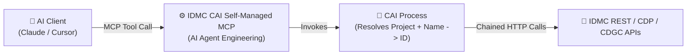

# Step-by-Step Tutorial: How to Connect to Informatica IDMC MCP Servers 🔌🤖

This guide walks through **all three methods** for connecting AI assistants (**Claude Desktop**, **Claude Code**, **Cursor**, **VS Code Copilot**, or **Google Antigravity**) to **Informatica IDMC** via the **Model Context Protocol (MCP)**:

1. **Method 1:** Connecting to **Informatica's Native Shared MCP Servers** (*IDMC AI Agent Engineering*).
2. **Method 2:** Building & Connecting a **Self-Managed MCP Server inside IDMC using Cloud Application Integration (CAI)**.
3. **Method 3:** Connecting **Our Custom Project-Scoped Python MCP Server** (with hardcoded single-project isolation for Taskflows, Profiling, CDGC Rule Occurrences, and CLAIRE Insights).

---

## Method 1: Connect to Informatica Native Shared MCP Servers (Official IDMC UI)

Informatica IDMC includes built-in **Shared MCP Servers** under the **AI Agent Engineering** service (such as *Catalog Discovery*, *Data Exploration*, and *Job Management*).

### Prerequisites
- An active **IDMC Organization** with **AI Agent Engineering** and **CLAIRE** enabled.
- An IDMC user role with permissions for **MCP Server Consumer**, **Data Integration**, and **Cloud Data Governance and Catalog**.

### Step 1: Locate Shared MCP Servers in IDMC
1. Log into your Informatica IDMC portal (e.g., `https://dm-us.informaticacloud.com`).
2. Open the **Application Launcher** (9-dot grid icon) and select **AI Agent Engineering**.
3. In the left-hand navigation pane, click **MCP Servers** $\rightarrow$ **Shared MCP Servers**.
4. Browse the available native servers:
   - **Catalog Discovery / Data Exploration:** Exposes CLAIRE catalog search, glossary lookup, and semantic discovery tools.
   - **Job Management:** Exposes job execution and monitoring tools.

### Step 2: Copy the MCP Connection Snippet
1. Click on the desired Shared MCP Server (e.g., **Catalog Discovery**).
2. Switch to the **Configuration** tab.
3. Configure the dropdown options:
   - **Auth Type:** Select `Generic` (or `OAuth 2.0` if your org uses an external IdP token relay).
   - **Connection Type / Client:** Select `VS Code` (standard JSON schema).
4. Click **Copy** to copy the generated JSON block to your clipboard.

### Step 3: Adapt the JSON for Claude / Cursor / Antigravity (`.mcp.json`)
> [!WARNING]
> **Critical Syntax Quirk in IDMC's Exported Snippet:**
> When you copy the `VS Code` configuration from IDMC AI Agent Engineering, Informatica sets the root JSON key to `"servers"` or `"server"`. For **Claude Desktop**, **Claude Code**, **Cursor**, and **Antigravity**, you **must** rename the top-level key to `"mcpServers"`.

Create or edit `.mcp.json` in your workspace (or `claude_desktop_config.json`):

```json
{
  "mcpServers": {
    "informatica-catalog-discovery": {
      "url": "https://idmc-api.dm-us.informaticacloud.com/ai-agent-engineering/mcp/v1/catalog-discovery/sse",
      "headers": {
        "Authorization": "Bearer <YOUR_INFA_JWT_TOKEN>",
        "X-INFA-ORG-ID": "<YOUR_INFA_ORG_ID>"
      }
    },
    "informatica-job-management": {
      "url": "https://usw5.dm-us.informaticacloud.com/ai-agent-engineering/mcp/v1/job-management/sse",
      "headers": {
        "Authorization": "Bearer <YOUR_INFA_JWT_TOKEN>",
        "X-INFA-ORG-ID": "<YOUR_INFA_ORG_ID>"
      }
    }
  }
}
```

---

## Method 2: Build a Self-Managed MCP Server in IDMC via Cloud Application Integration (CAI)

As documented in Informatica's *"3 Steps to Build a Self-Managed MCP Server in IDMC"*, native Shared MCP Servers sometimes expect internal FRS IDs (e.g., `2bF9l...z9`) rather than human-readable asset names, or lack custom project scoping. You can solve this natively inside IDMC using **Cloud Application Integration (CAI)**:



### Step 1: Create Service Connectors in CAI
1. Open **Application Integration** in IDMC.
2. Click **New** $\rightarrow$ **Service Connectors** to wrap the backend IDMC REST endpoints:
   - Action 1: `Login_v3` (`POST /saas/public/core/v3/login`)
   - Action 2: `Lookup_Object_By_Project` (`GET /saas/public/core/v3/objects?q=type=='TASKFLOW'`)
   - Action 3: `Run_Taskflow` (`POST /active-bpel/rt/{taskflowName}`)
   - Action 4: `Get_Profile_Rule_Occurrences` (`GET /profiling-service/api/v1/ruleOccurrence/...`)
3. Publish the Service Connector and create an **App Connection** for it.

### Step 2: Create and Publish the CAI Process
1. Click **New** $\rightarrow$ **Processes**.
2. Define clear **Input Fields** with detailed descriptions (CLAIRE/MCP uses these descriptions as the LLM tool schema, e.g., `taskflow_name`: *"Exact name of the taskflow inside the Finance project"*).
3. Hardcode or assign a Process Variable `v_ProjectName = "Finance_Customer360"` so users cannot override the project scope.
4. Chain the Service Connector actions inside the process canvas and map the output fields.
5. In the **Start** tab, set **Allow anonymous access** or assign an **API Gateway User Group**, and **Publish** the process on the Cloud Server or Secure Agent.

### Step 3: Register the CAI Process as a Self-Managed MCP Server
1. Navigate to **AI Agent Engineering** $\rightarrow$ **MCP Servers** $\rightarrow$ **Self-Managed MCP Servers**.
2. Click **New MCP Server**, select your published **CAI Process(es)** as the exposed tools, and click **Publish**.
3. Copy the resulting SSE URL into your `.mcp.json` just like in Method 1.

---

## Method 3: Connect Our Custom Project-Scoped Python MCP Server (Recommended for Full Control)

This repository includes a complete Python `FastMCP` server ([`src/idmc_mcp_server.py`](file:///c:/obData/investigating-informatica-idmc-mcp/src/idmc_mcp_server.py)) that chains **Platform v3 REST**, **ActiveVOS Taskflow**, **Cloud Data Profiling**, **CDGC Rule Occurrences**, and **CLAIRE Metadata Insights** while strictly enforcing a single hardcoded `IDMC_PROJECT_NAME`.

### Step 1: Verify Python Dependencies
Ensure `mcp`, `httpx`, and `pydantic` are installed in your Python environment:

```powershell
pip install mcp httpx pydantic
```

### Step 2: Configure `.mcp.json` with Your Hardcoded Project
Because each user only has access to **one project**, you configure `IDMC_PROJECT_NAME` directly inside the `env` block of the MCP configuration. The user never passes a project name in chat—every tool automatically locks onto `IDMC_PROJECT_NAME`.

Add the following block to your MCP client configuration (e.g., `.mcp.json` in your workspace, or `%APPDATA%\Claude\claude_desktop_config.json`):

```json
{
  "mcpServers": {
    "informatica-idmc-project": {
      "command": "python",
      "args": [
        "c:/obData/investigating-informatica-idmc-mcp/src/idmc_mcp_server.py"
      ],
      "env": {
        "IDMC_PROJECT_NAME": "Finance_Customer360",
        "IDMC_MOCK_MODE": "true",
        "IDMC_LOGIN_URL": "https://dm-us.informaticacloud.com",
        "IDMC_POD_BASE_URL": "https://usw5.dm-us.informaticacloud.com",
        "IDMC_PROFILING_BASE_URL": "https://usw5-dqprofile.dm-us.informaticacloud.com",
        "IDMC_CDGC_BASE_URL": "https://idmc-api.dm-us.informaticacloud.com",
        "IDMC_USERNAME": "svc_finance_mcp@company.com",
        "IDMC_PASSWORD": "YOUR_IDMC_PASSWORD",
        "IDMC_ORG_ID": "011ABC00000000000001"
      }
    }
  }
}
```

> [!TIP]
> **Start in Mock Mode (`"IDMC_MOCK_MODE": "true"`), Switch to Live Mode (`"false"`) When Ready:**
> When `IDMC_MOCK_MODE` is `"true"`, the server simulates realistic Informatica IDMC responses for `Finance_Customer360` (including successful/failed taskflows, subtask error traces, column profiling stats, CDGC Rule Occurrence scores, and CLAIRE insights) so you can test the entire conversational UX immediately. Set `"IDMC_MOCK_MODE": "false"` and provide your IDMC credentials to execute live REST API calls against your pod.

### Step 3: Verify Available Tools & Natural Language Prompts
Restart your MCP client and verify that the 5 tools are registered:
1. `get_taskflow_runs`
2. `list_project_taskflows`
3. `execute_project_taskflow`
4. `get_project_profiling_and_dq_scores`
5. `get_claire_project_insights`

Try these natural-language prompts in your AI client:
- **Monitor & Troubleshoot (Issue #1):**
  > *"Which taskflows have run in my project over the last 24 hours, and why did any of them fail?"*
- **Discover & Execute (Issue #2):**
  > *"List the available taskflows in my project and execute `tf_Daily_Customer360_Refresh`."*
- **Project Profiling & DQ Rule Occurrences (Issue #3):**
  > *"Show me the profiling results and CDGC Data Quality rule occurrence scores for my project, highlighting any rules that breached their threshold."*
- **CLAIRE Insights (Issue #4):**
  > *"Use CLAIRE insights to explain whether any data quality anomalies or sensitive PII classifications are impacting our failed pipelines."*
